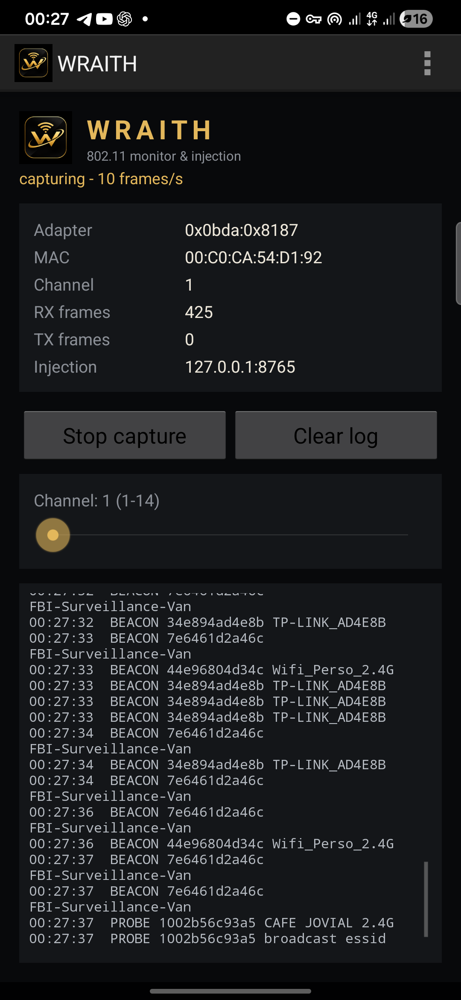

# WRAITH

**802.11 monitor mode, frame capture and packet injection on an unrooted Android
phone, using an external USB Wi-Fi card.**

WRAITH is a user space port of the Linux `rtl8187` driver for the
[ALFA AWUS036H](https://www.amazon.com/gp/product/B000QYGNKQ/) (RTL8187).
Android never sees the card as a network interface, which is exactly why this
works without root: the driver talks to the hardware over USB directly. The
trade-off is that ordinary packet tools cannot open the card, so the app exposes
its transmit path as a small local socket that the bundled
[`wraith`](tools/wraith) command drives from Termux.

## What works today

| | |
| --- | --- |
| Monitor mode | without root, on any Android with USB host support |
| Frame capture | libpcap in `/sdcard/wraith/capture.pcap`, plus a text log |
| Live view | beacons and probe requests decoded and shown as they arrive |
| Channel control | channels 1-14, from the app or from the shell |
| Packet injection | raw frames, deauth, beacon and pcap replay at 1 Mbit/s |
| GPS tagging | capture log gets position fixes when location is granted |
| Phone Wi-Fi | untouched — it stays connected while the card works |

Packet injection was verified on a Galaxy A15 (Android 16) with a second radio:
beacons injected on channel 6 and channel 11 were seen by the phone's own Wi-Fi
chip at 2437 MHz / -44 dBm and 2462 MHz / -45 dBm.

## Requirements

1. An ALFA AWUS036H (`0bda:8187`) and a USB OTG adapter.
2. A phone with USB host (OTG) support, Android 6 or newer.
3. For the shell tools: Termux with `python3` and `nc`.

The RTL8187B variants are detected but untested; other Realtek cards are not
supported.

## Install

The app is built locally into `wraith.apk`:

```bash
adb install -r wraith.apk
```

Plug the card in through OTG and launch the app; it asks for USB and storage
permission, probes the card, then starts capturing. See
[docs/BUILDING.md](docs/BUILDING.md) to build it yourself.

Install the Termux command from a checkout:

```bash
bash tools/install-wraith.sh
wraith doctor
```

`liber` and `liber80211` are installed as aliases so older notes keep working.

## The app



A status panel (adapter, MAC, channel, RX/TX counters, injection socket), a
capture start/stop button that leaves the radio initialised, a channel slider,
and the live frame log.

## The `wraith` command

```text
wraith info                 what the app is doing right now
wraith channel 6            retune the radio
wraith deauth AA:BB:CC:DD:EE:FF [client]
wraith beacon "Free WiFi"
wraith raw c0000000ffffffffffff...
wraith replay capture.pcap --count 5
wraith capture ls           list captures
wraith capture pull         copy captures out of /sdcard
wraith capture info         summarise capture.pcap
wraith log -f               follow the newest log
wraith doctor               check the install and the app
```

Full details, including how to write your own client, are in
[docs/USAGE.md](docs/USAGE.md) and [docs/PROTOCOL.md](docs/PROTOCOL.md).

## Limitations, stated plainly

- **`aireplay-ng` and `aircrack-ng` do not work with this app.** They open a
  monitor-mode interface through libpcap, and a user space driver deliberately
  provides none. Use `wraith` for deauth, beacon, raw and replay work.
- **The card cannot be used as an internet adapter.** No kernel driver means no
  network interface, so Android cannot route through it. Keep the phone's own
  Wi-Fi or mobile data for connectivity; the two radios do not interfere.
- **Injection goes out at 1 Mbit/s.** That is a basic rate every client must
  understand; management frames sent at higher rates are often ignored.
- **Monitor mode is receive-only until you inject.** There is no BSS
  association, so features that need a joined network (WPA handshakes) are out
  of scope for now.
- **No radiotap headers** in the pcap: link type 105, raw 802.11.
- **One card at a time**, RTL8187 only.
- **Captures from before the rename** are still in `/sdcard/liber80211`; the app
  now writes to `/sdcard/wraith`.

## Repository layout

```
src/                     the app (Java, no third-party dependencies)
  USBIO.java             the driver: registers, RF, RX/TX paths
  RxThread.java          capture loop and frame decoding
  InjectServer.java      loopback socket that carries injected frames
  PcapWriter.java        libpcap writer
  Stats.java             shared counters for the UI and the socket
res/                     layout, colours, strings, icons
tools/wraith             the Termux command
tools/wraith-inject.py   its Python client (protocol implementation)
docs/                    usage, protocol, building, screenshots
```

## Credits

- **GUURUUU** — creator and maintainer — https://github.com/GUURUUU
- **hotshado** — collaborator (upstream testing ground) — https://github.com/hotshado

## License

GPL v2, inherited from the Linux driver this port is based on. See
`COPYING`/the file headers.
